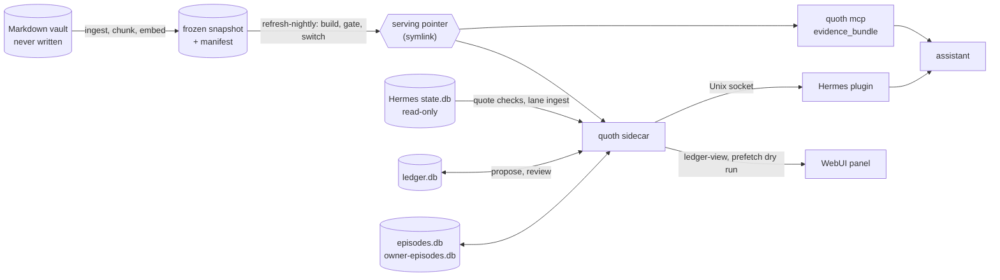

# Architecture

quoth gives a personal AI assistant two kinds of memory and keeps them apart:

- **evidence**: what the owner's Markdown vault says, served from an immutable snapshot
  with exact provenance (path, heading, line range);
- **core memory**: a short list of reviewed facts in a ledger, compiled into a block
  the assistant loads every session.

Everything runs locally on CPU. Nothing listens on the network.

## Components

| Component | Code | What it does |
|---|---|---|
| Evidence engine | `ingest.py`, `chunker.py`, `embed/`, `dense.py`, `search.py`, `retrieval.py`, `live.py`, `snapshot_contract.py`, `evidence.py`, `evidence_service.py` | Incremental vault ingest by path and SHA-256; heading-aware chunks (about 1,200 characters with 200 of overlap, long paragraphs cut at sentence ends) with line locators; BGE-M3 vectors of each chunk under its note title, aliases and heading path; hybrid top-k (dense + BM25 + trigram + named notes, RRF) with path and tier pre-filters and per-note diversity; links, per-hit freshness and bounded evidence bundles |
| Snapshots | `refresh.py`, `freshness.py`, `serving.py`, `migrations/` | The evidence schema (vault notes, versions, chunks, vectors and the lexical indexes); builds a new frozen snapshot plus manifest, checks freshness against the vault and the code, admits a snapshot (or a symlink pointer to one) for read-only serving |
| Bundles | `bundle.py` | Portable full or scope-only copies of a snapshot with a verifiable manifest |
| Nightly refresh | `nightly.py`, `quality.py`, `heartbeat.py`, `gold_drift.py` | Builds a successor when the vault changed, scores it against the serving snapshot, switches the pointer only when it passes, writes receipts and a heartbeat |
| Ledger | `ledger/` | Typed claims with origin and authority, write-time reconcile, owner review, bitemporal history, core-block compile |
| Episode lanes | `episodes.py` | Two searchable records of earlier chats: what the assistant said, and what the owner wrote |
| Sidecar | `sidecar.py`, `recall_defaults.py`, `relevance.py`, `rerank.py`, `claim_index.py`, `prefetch_log.py` | The long-running process: loads the model once and serves core, recall, evidence, review and lanes over a Unix socket |
| Hermes plugin | `hermes_plugin/quoth/` | A stdlib-only memory provider for the Hermes agent that talks to the sidecar |
| WebUI panel | `control/`, `web/control-surface/` | Read-only memory views for the Hermes WebUI: overview, ledger, review queue, core, recall playground, episodes, refresh history |
| MCP server | `mcp_server.py` | `quoth mcp`: one read-only tool, `evidence_bundle`, over stdio |
| Evals | `evals/` | Eval set v1, a harness that scores the real prefetch path, receipts, compare, threshold sweeps, online log readout |

## Data flow

1. `quoth ingest` and `quoth embed` index the vault into a development database. The
   vault is only read.
2. `quoth refresh` (or `quoth refresh-nightly` on a schedule) builds a new snapshot from
   a frozen source and the current vault, verifies it and freezes it with a manifest.
3. The serving path opens the snapshot read-only. `quoth mcp` and the sidecar both use
   `evidence_service.py`, so the MCP tool and the sidecar's `/v1/evidence` return the
   same bytes.
4. On each owner turn, the plugin asks the sidecar for recall (`/v1/prefetch`). The
   sidecar embeds the query once, ranks a pool of candidates per store (accepted claims by
   meaning and by words, vault hits, optionally the lanes), judges each candidate with the
   relevance gate on the text it would inject, and fills the slots with the best that pass.
   It formats them as one `<quoth-recall>` block, with one line saying why when the vault
   shows nothing (late, unavailable, nothing above the floor). Every budget, count and floor
   of this path lives in `recall_defaults.py`.
5. When the assistant wants to keep something, it proposes a claim. The claim stays
   pending until the owner accepts it in chat, unless a narrow auto-accept rule holds.
6. `quoth ledger compile-core --publish` writes the accepted claims as the core block
   that the plugin loads at session start.

## Trust boundaries

- **Serving is read-only.** Snapshots open with SQLite `mode=ro` and `query_only=ON`,
  and are checked against their manifest digest before use. `quoth mcp` registers one
  tool and has no write path. The lane and ledger connections used by read-only views
  (`/v1/ledger-view`) are separate `mode=ro` connections.
- **The vault is never written.** Nothing in quoth opens a vault file for writing.
- **The sidecar's Unix socket is its trust boundary.** There is no authentication on top:
  any process that can connect (the socket's owner and group, mode 0660 by default) can
  read memory and propose claims. Keep the socket's directory and group limited to the
  agent gateway and the operator.
- **Authorship is never taken from the caller.** A claim counts as the owner's words only
  when its quote is found in an owner-authored message of the calling session in the
  agent's `state.db`. Review decisions need the owner's own reply in the current turn,
  and a review request must state its conversation context; decisions run only in the
  primary context.
- **Retrieved text is evidence, not instruction.** Every evidence response carries an
  `answer_use` contract that tells the caller to treat excerpts as untrusted data, cite
  them, and never infer absence from missing top-k hits. Lane hits carry their own
  `origin` and `authority` (`none` for the assistant's words, `unreviewed` for the
  owner's).
- **Logs carry no content.** The sidecar never logs request bodies. The optional prefetch
  log stores hashes, ids, locators, scores and timings, never query or excerpt text.

## Design decisions

**Hybrid retrieval, judged by cosine.** One function (`retrieval.py`) ranks vault hits for
recall and for `evidence_bundle`: BGE-M3 cosine fused by reciprocal rank with the snapshot's
BM25 and trigram lists and the notes the query names, so exact names and paths a dense model
blurs are found. One multilingual model covers mixed-language vaults, runs on CPU through
ONNX Runtime, and gives scores with an absolute meaning, which the relevance gate needs: every
hit keeps its real cosine, and a lexical-only hit below the floor passes only when the query
names its note. Path and recall-tier filters apply before ranking. The lexical lists are not
a fallback: if the model or the vectors are missing, serving fails instead of degrading.
Model files are never downloaded at serving time. `--retrieval dense` keeps the cosine-only
ranking for comparison.

**Provenance a caller can act on.** Every hit names its project (top-level folder), the notes
its chunk links to (fetchable by path, so a caller reads the canonical source rather than a
mention of it), and, with the vault root configured, whether its note changed since the
snapshot was built; the bundle says when that was. The snapshot-side facts come through one
module (`snapshot_contract.py`).

**Immutable snapshots.** A snapshot is built once, frozen (mode 0444) and never written
again; its manifest records the database digest, the code digests of every file that
shapes the stored data, the model manifest and the vault inventory. Serving switches
between snapshots by repointing a symlink, so rollback is repointing it back. A snapshot
built by different index code is reported as incompatible rather than silently reused.

**Claims are never deleted.** The ledger is bitemporal: a claim has `valid_from`/`valid_to`
and `recorded_at`. Replacing a fact supersedes the old claim (`superseded_by`), forgetting
sets `valid_to`, and every decision is appended to `ledger_events`. Claim text is immutable
(a trigger enforces it); an edit creates a new claim. Any decision can be traced and undone.

**Only the owner has authority.** Every claim records its origin: the owner's own words,
the owner's notes, the assistant's inference, or imported text. The assistant's inferences
are served only after the owner accepts them, and are marked `[inferred]` in the core.
Decisions need the owner's approving reply in the current turn, verified against the chat
history, so the assistant cannot approve its own proposals.

**The assistant's own notes are excluded.** `ASSISTANT/` folders are skipped at ingest
(`scopes.toml`), and a snapshot holding current `ASSISTANT/` content is invalid. Hidden
folders and notes are skipped too, as Obsidian hides them: they hold tool state, sync-tool
copies of old versions and agent instructions, not the owner's notes. An
assistant that writes notes into the vault would otherwise read its own output back as
independent evidence and reinforce it. The assistant's chat replies live in their own lane
with `authority: none` and are off in recall by default.

**One process owns the model.** The sidecar loads BGE-M3 once and shares it between vault
evidence, claim ranking and both lanes. The agent's gateway stays stdlib-only. Background
work (lane embedding, claim indexing) yields to live turns, and a turn waits for evidence
at most 1.5 seconds before answering with word-matched claims only.

**One decision path for recall.** One module (`recall_defaults.py`) holds every budget,
count, cap and floor; one lexical measure (`relevance.terms`: stopword-free, lightly stemmed,
Russian included) selects word-matched claims and feeds the gate; the gate runs before the
cut, on the injected text, so a dropped slot refills; and the eval harness replays the same
functions, so a threshold chosen offline behaves the same live.

**Measure on the served path.** The eval harness scores the same dry-run prefetch the
assistant receives, and the nightly gate scores both snapshots with the same harness, so
a quality number always describes what is actually served.
